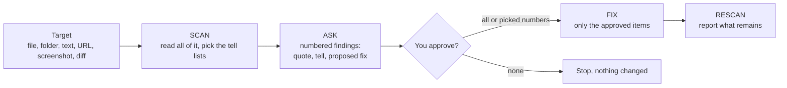

# /anti-ai

Finds the signs of AI-made work in anything you point it at, asks before each removal, then removes
what you approve.

Targets: writing of every kind (post, DM, email, doc, README, PR body, ad copy), web design (30
vibe-coded tells such as harsh gradients, three feature cards in a row, fake testimonials) and
code.

Flow: SCAN, ASK, FIX, RESCAN. Every finding shows the exact quote, the tell name and the proposed
fix. Nothing changes before you answer. A fix that needs a fact only you know becomes a question.
The skill never invents the fact.

Load it before you write or build, to avoid every tell up front.

## Install

```bash
cp -r anti-ai ~/.claude/skills/anti-ai
```

## Usage

```
/anti-ai README.md
/anti-ai src/
/anti-ai https://your-site.com
/anti-ai does this sound like AI: <pasted text>
/anti-ai write the hero headline for a dog walking app
```

## How it works


