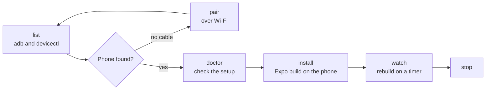

# /app-install

Finds the real phones attached to this computer, installs an Expo or React Native build on one, and
keeps it current on a timer.

One script does the work: `scripts/app-target.sh [list|pair|doctor|install|watch|stop|watch-status] [<target>]`.
It checks Android over `adb` (wired and Wi-Fi) and iPhone over `xcrun devicectl`. It finds the app
directory from `app.config.ts`, `app.config.js` or `app.json`. It uses real hardware only, never a
simulator.

Android works on macOS and Linux. iPhone detection and iPhone builds need macOS with Xcode.

## Install

```bash
cp -r app-install ~/.claude/skills/app-install
```

## Usage

```
/app-install                      list the phones this computer can see
/app-install install the latest build on my phone
/app-install keep rebuilding it
/app-install stop the watch
```

## How it works


