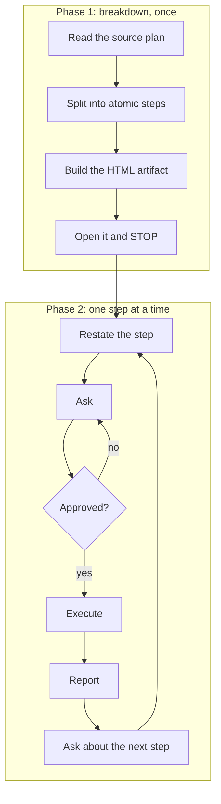

# /atomic-plan

Breaks a complex multi-step plan into the smallest atomic steps, renders the breakdown as a visual HTML artifact, then executes one step at a time with explicit approval before AND after each step.

```bash
cp atomic-plan/SKILL.md ~/.claude/skills/atomic-plan/SKILL.md
```

```
/atomic-plan
```

## When to use

You have a big plan (markdown doc, HTML plan, ClickUp task, or chat description) and want to execute it slowly with maximum oversight. Each step has one owner, one verifiable outcome, and commit-sized scope. Decisions surface inline at the step that depends on them, never bundled upfront.

Use when you say "atomic plan", "break this into atomic steps", "smallest atomic pieces", "ask before each step", "step-by-step with check-ins".

## atomic-plan vs autoplan vs plan-eng-review

- `/autoplan` runs parallel reviews on a plan.
- `/plan-eng-review` critiques a plan before execution.
- `/atomic-plan` executes an existing plan slowly with per-step gates. Pair it after one of the above.

## Output

- `<project-root>/<plan-name>-atomic-plan.html` opened in your browser.
- Then per-step chat updates: restate, ask, execute, report, ask next.

## How it works


