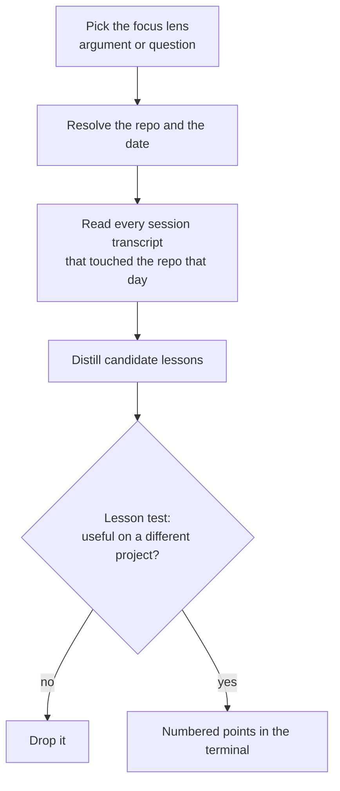

# /eod

End-of-day harvest of what you learned as an engineer, not a status report of what shipped.

It reads every Claude Code session that touched the repo that day, not only the current terminal.
It returns numbered points, each with a short explanation: portable principles, tools and flags
learned, traps to avoid and reusable domain facts. Each point must help on a different project.
Project-only facts are dropped.

You pick a focus lens: engineering, process and workflow, domain knowledge, product and judgment,
or everything. Pass it as an argument or choose it when asked. The output prints in the terminal.
It writes no files.

## Install

```bash
cp -r eod ~/.claude/skills/eod
```

## Usage

```
/eod                      today, asks for the lens
/eod frontend             today, with a free-form lens
/eod 2026-06-01           one past date
/eod week                 the last week
/eod week caching         date and lens together
```

## How it works


