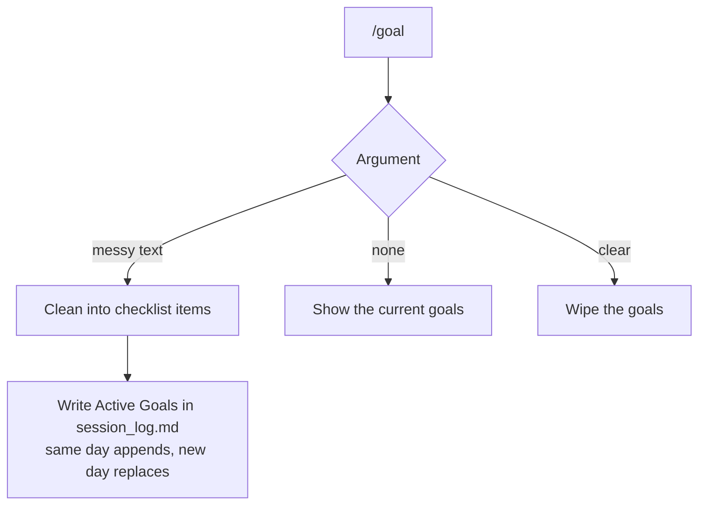

# /goal

Set session goals at the start of a conversation. Accepts messy, ungrammatical input and turns it into clean checklist items. Goals live in `session_log.md` as an `## Active Goals` section -- same file `/log` writes to, no extra files.

Works with `/tldr` (shows progress on goals set in the current conversation) and `/log` (archives goals into the session entry when you log).

## Modes

```
/goal fix umbra bug and merge prs idk maybe readme too
```

Saves:

```
- [ ] Fix the Umbra bug
- [ ] Merge the stacked PRs
- [ ] Start drafting the README
```

```
/goal              # view current goals
/goal clear        # wipe goals
```

Same day = appends. New day = replaces stale goals.

## Install

```bash
cp goal/SKILL.md ~/.claude/commands/goal.md
cp tldr/SKILL.md ~/.claude/commands/tldr.md   # reads goals set in the current conversation
cp log/SKILL.md ~/.claude/commands/log.md     # updated to archive goals
```

## How it works


