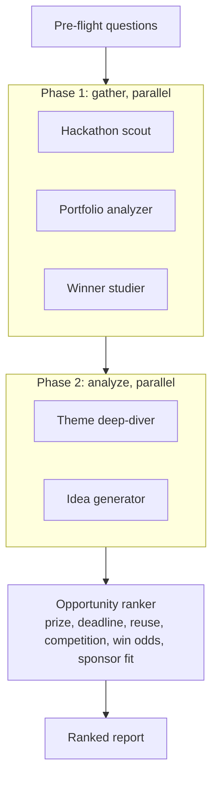

# /hackathon-radar

Finds open crypto/AI/blockchain hackathons and suggests what to build based on your existing projects. Runs 6 agents in parallel -- scouts hackathons, analyzes your portfolio, studies past winners, digs into tracks/bounties, generates ideas, and ranks everything.

If an agent fails, the rest keep going.

## Install

```bash
cp -r hackathon-radar ~/.claude/skills/hackathon-radar
```

## Usage

```
/hackathon-radar
/hackathon-radar DeFi agents
```

## How it works



If one agent fails, the rest keep going.
