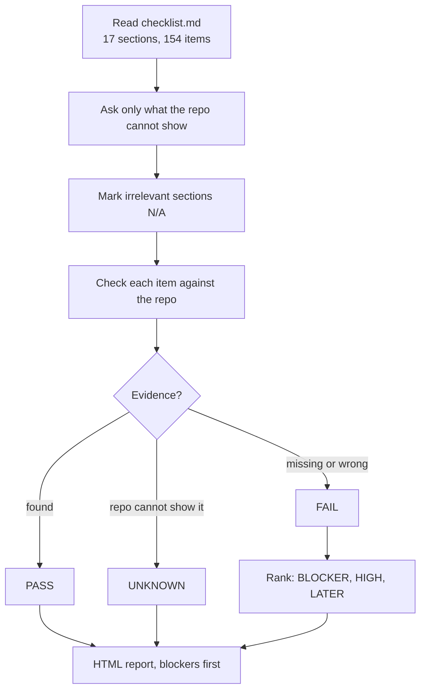

# /pre-launch

Audits an app against a 154-item checklist before it meets a paying customer.

The checklist has 17 sections: auth, data, security, compliance, infra, observability, testing,
billing, API, AI features, UX, code health and the people the app still needs. The skill asks only
the questions the repo cannot answer (first customer, patient or card data, AI model, payments).
It marks irrelevant sections N/A.

Each item gets one status: PASS (with file and line), FAIL, UNKNOWN (you must confirm) or N/A.
FAIL items rank as BLOCKER, HIGH or LATER. The report is an HTML page with the blockers first.

## Install

```bash
cp -r pre-launch ~/.claude/skills/pre-launch
```

The skill reads `checklist.md` in the same folder, so copy the whole folder.

## Usage

```
/pre-launch
/pre-launch is this ready to launch
/pre-launch production readiness for the billing service
```

## How it works


