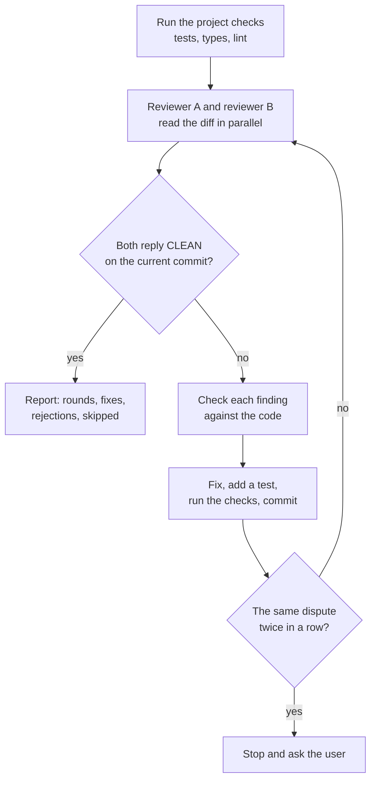

# /review-loop

Two independent reviewers read the same change in parallel. You fix every real finding. They read
again. The loop ends when both reply `CLEAN` on the same final commit.

Use it before you merge a change that is hard to undo, such as a release tool, a migration or an auth change.

## Install

```bash
cp -r review-loop ~/.claude/skills/review-loop
```

## Usage

```
/review-loop 1850
/review-loop           # the current diff against the base branch
```

## How it works



## The two reviewers

| Reviewer | Angle |
|---|---|
| A, strongest model | Adversarial: external API behaviour, failure paths, state left behind, guards, docs that lie |
| B, a different model | Project rules, weak tests, line-by-line read, docs against code, runs tests and lint |

## Rules

- The reviewers are read-only. One writer fixes, so the history stays readable.
- A `CLEAN` counts only for the code as it stands now.
- The loop never pushes, merges or deploys.
