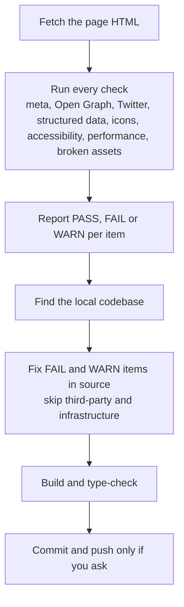

# /seo

Audits a URL for SEO, accessibility, and social previews. Checks meta tags, Open Graph, Twitter cards, structured data, favicons, landmarks, contrast, tap targets, and performance. Reports findings and applies fixes to your codebase.

## Install

```bash
cp -r seo ~/.claude/skills/seo
```

## Usage

```
/seo https://your-site.com
```

## How it works


