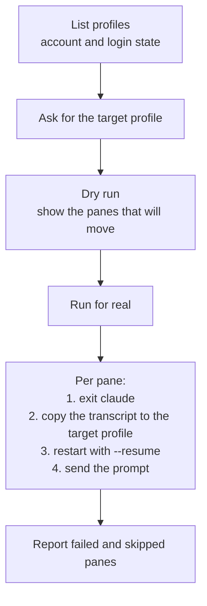

# /swap-profile

Moves every claude pane in the current [herdr](https://herdr.dev) tab onto another Claude account
profile, with each pane's context kept. Use it when one account hits its usage or spend limit.

For each pane the script exits claude, copies the transcript into the target profile, restarts
claude with `--resume`, and sends a prompt (`continue` by default). It also accepts the startup
trust gates in the target profile, so the pane resumes with no keypress.

## Requirements

- `herdr`, with the panes in one tab
- One fish function per profile that sets `CLAUDE_CONFIG_DIR`
- macOS (the login check reads the keychain)

## Install

```bash
cp -r swap-profile ~/.claude/skills/swap-profile
```

## Usage

```
/swap-profile
```

Direct script options:

```
python3 scripts/swap-profile.py --list-profiles
python3 scripts/swap-profile.py --profile work --dry-run
python3 scripts/swap-profile.py --profile work
```

## How it works


