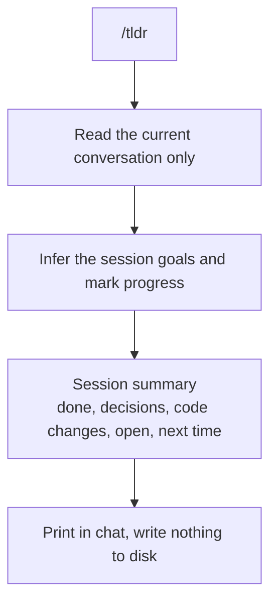

# /tldr

Prints a summary of the current session to the conversation. It reads only the current conversation: no `session_log.md`, no memory folder, no other session. Goals come from the conversation itself.

Nothing gets written to disk.

```bash
cp tldr/SKILL.md ~/.claude/commands/tldr.md
```

```
/tldr
```

## tldr vs log

`/tldr` reads the current conversation and prints a summary. `/log` writes to the session log. Use `/tldr` to recap this session, `/log` to save state for the next one.

## How it works


