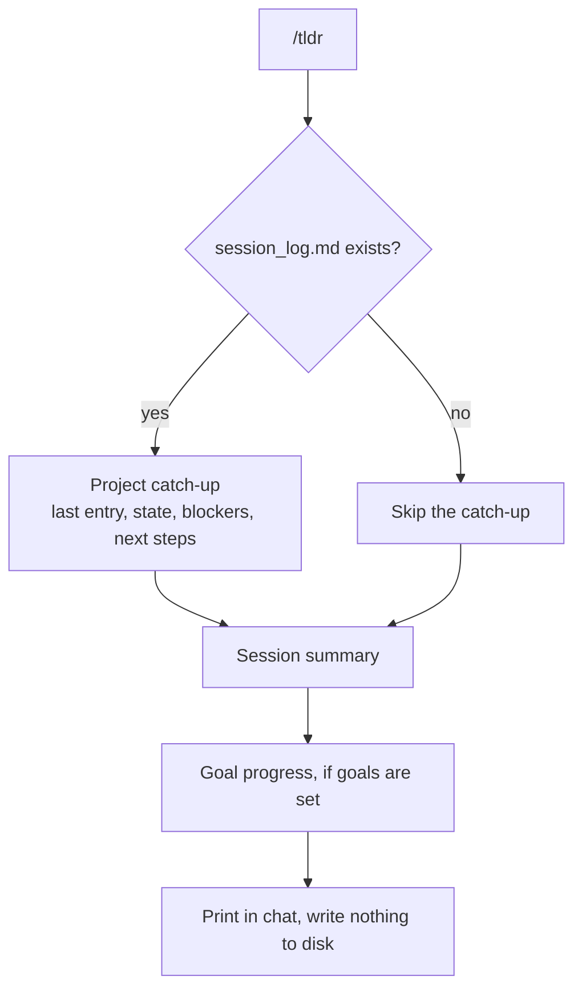

# /tldr

Prints a session summary to the conversation. Reads the project's `session_log.md` for context from previous sessions and shows active goal progress if any are set via `/goal`.

Nothing gets written to disk.

```bash
cp tldr/SKILL.md ~/.claude/commands/tldr.md
```

```
/tldr
```

## tldr vs log

`/tldr` reads the session log and prints a summary. `/log` writes to the session log. Use `/tldr` to catch up, `/log` to save state.

## How it works


