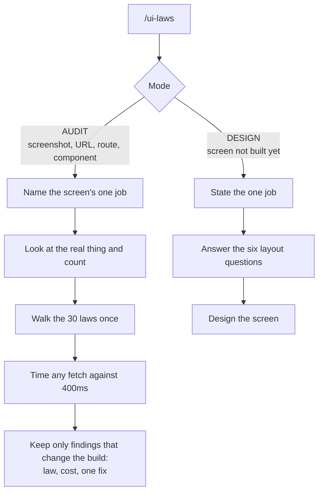

# /ui-laws

Audits or designs a UI against the 30 psychology laws behind interface decisions (Laws of UX
by Jon Yablonski). Every finding names the law, who pays for the defect, and one concrete fix.
Numbers come with it: 400ms for the Doherty Threshold, 4 to 7 chunks of working memory, 7 plus
or minus 2 for Miller's Law.

Two modes. AUDIT takes a screenshot, a URL, a route, or a component file and reports the
violations worst-first. DESIGN takes a screen that does not exist yet and hands back the six
questions that constrain it before any code is written.

It refuses to grade, refuses to invent a law, measures latency instead of estimating it, and
will not turn these laws into dark patterns.

## Install

```bash
cp -r ui-laws ~/.claude/skills/ui-laws
```

## Usage

```
/ui-laws                          audit the screen in front of you
/ui-laws src/app/settings/page.tsx
/ui-laws https://your-site.com
/ui-laws design a checkout step for one saved card
```

## How it works


